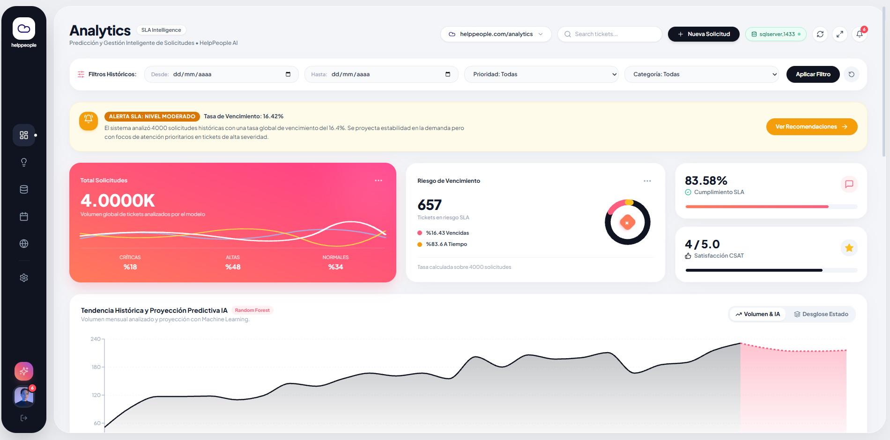
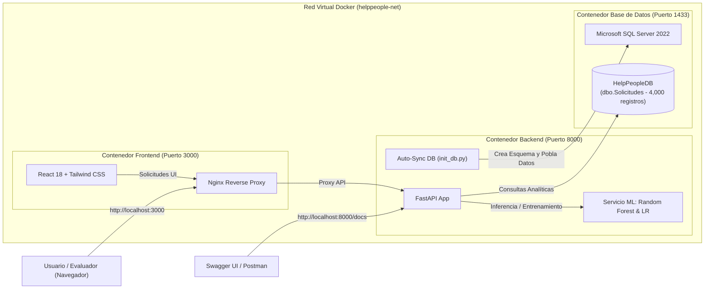

# ⚡ Hackathon #2 HelpPeople - Predicción y Gestión Inteligente de Solicitudes

Sistema integral para la optimización y analítica predictiva de incidentes en **HelpPeople**, combinando **Python (FastAPI)**, **Modelos de Machine Learning (Scikit-Learn: Random Forest & Regresión Lineal)**, **Microsoft SQL Server 2022** y una interfaz interactiva de alto rendimiento en **React.js**.


---

## ✅ Matriz de Cumplimiento y Checklist de la Hackathon

A continuación se detalla la validación punto por punto de todos los requerimientos técnicos y criterios de evaluación solicitados en el reto oficial:

| Requisito / Componente | Descripción en `reto.md` | Estado | Archivos / Evidencia de Implementación |
| :--- | :--- | :---: | :--- |
| **Frontend Framework** | Desarrollar el frontend utilizando React.js | **CUMPLIDO** | `frontend/src/App.jsx`, `frontend/package.json` (React 18 + Vite) |
| **Interactividad y Gráficos** | Gráficos interactivos de datos históricos y predicciones futuras | **CUMPLIDO** | [`ComparativeVolumeChart.jsx`](frontend/src/components/ComparativeVolumeChart.jsx), [`RiskPriorityChart.jsx`](frontend/src/components/RiskPriorityChart.jsx) |
| **Simulador de Parámetros** | Módulo para ajustar parámetros (meses, prioridades, categorías) y actualizar predicciones en tiempo real | **CUMPLIDO** | [`PredictionSimulationPanel.jsx`](frontend/src/components/PredictionSimulationPanel.jsx) con sliders dinámicos y llamadas reactivas a `/predict` |
| **Diseño y Accesibilidad** | Componentes modernos y accesibles (estilo PrimeReact/Vuetify/Tailwind) | **CUMPLIDO** | Interfaz ejecutiva moderna con Tailwind CSS, Lucide Icons, paleta dark theme y tipografía *Plus Jakarta Sans* |
| **Filtros Dinámicos** | Filtros personalizables por rango de fechas, prioridad y categoría | **CUMPLIDO** | Barra de filtrado global en [`App.jsx`](frontend/src/App.jsx) que actualiza consultas en `/historical-data` |
| **Visualización Comparativa** | Comparativa visual entre datos reales históricos y predicciones | **CUMPLIDO** | Curva de transición continua en [`ComparativeVolumeChart.jsx`](frontend/src/components/ComparativeVolumeChart.jsx) (Datos Reales vs. Proyección IA) |
| **Módulo de Recomendaciones** | Módulo para mostrar las recomendaciones estratégicas generadas | **CUMPLIDO** | [`RecommendationsModule.jsx`](frontend/src/components/RecommendationsModule.jsx) con tarjetas de acción, impacto y estimación de mejora |
| **Módulo de Analytics & Estadísticas** | Generación de estadísticas descriptivas y cuantitativas en tiempo real | **CUMPLIDO** | [`AnalyticsModule.jsx`](frontend/src/components/AnalyticsModule.jsx), endpoint `/analytics/statistics`, cálculo de momentos (P25-P95), días pico y exportador JSON/CSV |
| **Backend Framework** | Desarrollar el backend en Python | **CUMPLIDO** | [`backend/main.py`](backend/main.py) construido con **FastAPI** y servidor asíncrono Uvicorn |
| **Base de Datos SQL Server** | Manejar datos históricos de solicitudes en SQL Server | **CUMPLIDO** | [`schema.sql`](database/schema.sql) con índices, [`seed_data.sql`](database/seed_data.sql) (4,000 tickets), [`init_db.py`](database/init_db.py) y Docker SQL Server 2022 |
| **Endpoint: GET /historical-data** | Enviar datos históricos al frontend con filtros y agregaciones | **CUMPLIDO** | Implementado en [`backend/main.py`](backend/main.py#L65) con cálculo de KPIs, tendencias mensuales y muestra de tickets |
| **Endpoint: POST /predict** | Recibir parámetros (meses, prioridad) y devolver resultados predictivos | **CUMPLIDO** | Implementado en [`backend/main.py`](backend/main.py#L160) conectado al motor Scikit-Learn |
| **Endpoint: GET /recommendations** | Generar estrategias basadas en las predicciones | **CUMPLIDO** | Implementado en [`backend/main.py`](backend/main.py#L176) con diagnósticos de capacidad, cuellos de botella y SLA |
| **Modelo: Volumen Futuro** | Predecir volumen de solicitudes para los próximos meses (abiertas/cerradas/vencidas) | **CUMPLIDO** | Random Forest Regressor ($R^2 = 0.965$, $MAE = 5.83$, error $\pm 3.65\%$) en [`ml_service.py`](backend/ml_service.py) |
| **Modelo: Tasa de Vencimiento** | Predecir porcentaje de solicitudes que podrían quedar vencidas según prioridad | **CUMPLIDO** | Random Forest Classifier (**83.62%** de *accuracy*) en [`ml_service.py`](backend/ml_service.py) |
| **Modelo: Tiempo de Resolución** | Estimar tiempos promedio de resolución | **CUMPLIDO** | Regresor multivariado según severidad, categoría y departamento solicitante en [`ml_service.py`](backend/ml_service.py) |
| **Organización del Código** | Carpetas estructuradas: `database`, `backend`, `frontend` | **CUMPLIDO** | Arquitectura modular estricta solicitada por el reto |
| **Extra: Alertas Automáticas** | Notificación/alerta en dashboard ante alta probabilidad de vencimiento | **CUMPLIDO** | [`RiskAlertBanner.jsx`](frontend/src/components/RiskAlertBanner.jsx) detecta umbrales críticos de SLA y emite alertas automáticas |
| **Extra: Despliegue en 1 Comando** | Despliegue automatizado con contenedores | **CUMPLIDO** | [`docker-compose.yml`](docker-compose.yml) orquesta SQL Server, FastAPI y React Nginx con `docker-compose up --build` |

---

## 🏗️ Arquitectura del Sistema en Docker

El sistema se encuentra 100% contenerizado para su despliegue con un único comando:



---

## 🚀 Despliegue con Docker (Un Solo Comando)

### Prerrequisitos
- Tener instalado **Docker Desktop** en ejecución.

### Ejecución
Abre tu terminal en la raíz del proyecto (`d:\ProyectosWEB\TalentoTech`) y ejecuta:

```powershell
docker-compose up --build
```
*(o si usas la sintaxis moderna: `docker compose up --build`)*

### ¿Qué sucede automáticamente al ejecutar este comando?
1. **Levanta SQL Server 2022**: Se crea el contenedor `helppeople-sqlserver` y se inicia el motor en el puerto `1433`.
2. **Espera el Healthcheck**: El contenedor backend aguarda hasta que SQL Server esté listo para recibir conexiones.
3. **Inicialización y Poblado de Datos**: El script [`backend/entrypoint.sh`](backend/entrypoint.sh) ejecuta [`database/init_db.py`](database/init_db.py), el cual crea la base de datos `HelpPeopleDB`, aplica el esquema de tablas e inserta los 4,000 registros históricos.
4. **Entrenamiento de Modelos de Machine Learning**: Al arrancar FastAPI, el servicio entrena los algoritmos predictivos en memoria.
5. **Compilación y Servidor Web del Frontend**: Node compila los artefactos de React y Nginx los expone en `http://localhost:3000`.

---

## 🌐 Servicios y Puertos Expuestos

| Servicio | URL / Puerto | Descripción |
| :--- | :--- | :--- |
| **Frontend Web** | [http://localhost:3000](http://localhost:3000) | Dashboard ejecutivo interactivo, simulador de predicciones y alertas SLA. |
| **Backend API** | [http://localhost:8000](http://localhost:8000) | API REST en FastAPI. |
| **Documentación Swagger** | [http://localhost:8000/docs](http://localhost:8000/docs) | Explorador interactivo OpenAPI con pruebas en vivo de todos los endpoints. |
| **SQL Server** | `localhost:1433` | Motor de base de datos relacional (Usuario: `sa`, Contraseña: `HelpPeople*2024Secure`). |

Para detener el servicio:
```powershell
docker-compose down
```

---

## 📖 Explicación Detallada de Cada Proceso del Servicio

### 1. Proceso de Base de Datos e Ingesta de Datos (`database/`)

- **Esquema Relacional ([`schema.sql`](database/schema.sql))**:
  - Define la tabla `dbo.Solicitudes` con tipos de datos adecuados (`DATETIME2`, `NVARCHAR`, `FLOAT`, `BIT`).
  - Incluye **índices no agrupados** (`IX_Solicitudes_FechaSolicitud`, `IX_Solicitudes_Estado`, `IX_Solicitudes_Prioridad`, etc.) para garantizar un alto rendimiento en consultas analíticas de series temporales.
- **Poblado Masivo ([`seed_data.sql`](database/seed_data.sql) y [`dataset_solicitudes.csv`](database/dataset_solicitudes.csv))**:
  - Contiene **4,000 registros sintéticos** con correlaciones realistas entre prioridad, canales (Chatbot, Web, Teléfono, Correo), tiempos de resolución y satisfacción de clientes.
- **Sincronización Automática ([`init_db.py`](database/init_db.py))**:
  - Conecta a la base de datos maestra, valida si existe `HelpPeopleDB`, ejecuta el esquema y puebla las filas si la tabla está vacía.
  - Cuenta con un **fallback transparente** a SQLite en caso de ejecutarse fuera de Docker sin un servicio SQL Server activo.

---

### 2. Proceso de Inteligencia Artificial y Machine Learning (`backend/ml_service.py`)

El servicio de IA implementa 3 modelos complementarios desarrollados con **Scikit-Learn**:

#### A. Proyección de Volumen Mensual (Series de Tiempo)
- **Algoritmo**: `Random Forest Regressor` (100 estimadores) + Comparativa con `Linear Regression`.
- **Variables de Entrada**:
  - Tendencia lineal en el tiempo ($t$).
  - Mes del año ($1..12$).
  - Componentes estacionales cíclicos ($\sin(2\pi \cdot m / 12)$ y $\cos(2\pi \cdot m / 12)$).
  - Variable de retardo temporal ($Lag_1$).
- **Métricas Obtenidas**:
  - **$R^2$**: `0.965` (96.5% de varianza explicada).
  - **Margen de Error Promedio**: `±3.65%`.
  - **MAE**: `5.83` solicitudes.

#### B. Estimación de Tiempos de Resolución
- **Algoritmo**: `Random Forest Regressor` multivariado.
- **Variables**: Nivel de severidad, departamento solicitante, categoría de soporte y día de la semana.
- **Salida**: Horas promedio estimadas de resolución por cada ticket futuro.

#### C. Clasificación de Riesgo de Incumplimiento de SLA (Tickets Vencidos)
- **Algoritmo**: `Random Forest Classifier`.
- **Exactitud (Accuracy)**: `83.62%`.
- **Salida**: Probabilidad calibrada de que una solicitud quede vencida según su prioridad (Crítica: ~35%, Alta: ~24%, Media: ~16%, Baja: ~10%).

---

### 3. Proceso de API REST y Endpoints del Backend (`backend/main.py`)

La API cumple estrictamente con las especificaciones del reto:

- `GET /historical-data`:
  - **Parámetros opcionales**: `start_date`, `end_date`, `prioridad`, `categoria`, `limit`.
  - **Respuesta**: Resumen de KPIs (tasa de vencimiento, SLA cumplido, tiempo medio), agregados mensuales temporales, distribuciones categóricas y muestra paginada de registros.
- `POST /predict`:
  - **Cuerpo JSON**:
    ```json
    {
      "months_ahead": 4,
      "prioridad": "Todas",
      "categoria": "Todas"
    }
    ```
  - **Respuesta**: Proyección mensual de solicitudes (abiertas, cerradas, vencidas), tasa estimada de vencimiento, tiempo medio de resolución y métricas de exactitud del modelo.
- `GET /recommendations`:
  - **Respuesta**: Estrategias automáticas basadas en la demanda proyectada y patrones de riesgo (cola rápida para tickets críticos, redistribución de especialistas en áreas con cuellos de botella y metas de capacidad de agentes).
- `GET /analytics/statistics`:
  - **Parámetros opcionales**: `start_date`, `end_date`, `prioridad`, `categoria`.
  - **Respuesta**: Reporte estadístico y descriptivo completo (distribución Lunes a Domingo con día pico, momentos de resolución P25 a P95, matriz de canales, departamentos y resumen ejecutivo).
- `GET /filter-options`:
  - Provee las opciones dinámicas para los selectores del frontend (categorías, prioridades, rangos de fechas).
- `GET /db-status`:
  - Diagnóstico de la conexión a la base de datos (informa si se encuentra conectada a SQL Server o en modo contingencia).

---

### 4. Proceso del Frontend Interactivo (`frontend/`)

Desarrollado en **React.js** con **Tailwind CSS**, **Recharts** y **Lucide Icons**:

1. **Dashboard de Métricas Clave (KPIs)**:
   - Tarjetas dinámicas con indicadores de volumen, tasa de vencimiento, porcentaje de cumplimiento SLA y satisfacción del cliente (CSAT).
2. **Simulador Predictivo en Tiempo Real**:
   - Controles interactivos (deslizador de horizonte temporal de 1 a 12 meses, filtros por severidad y categoría).
   - Recálculo en tiempo real contra el endpoint `/predict`.
3. **Gráfico Comparativo Histórico vs. Predicción**:
   - Curva de área interactiva que integra la historia confirmada con la proyección futura de Machine Learning, identificando visualmente la frontera entre datos reales y pronosticados.
   - Alternancia entre *Curva Predictiva* y *Desglose Apilado por Estado* (Cerradas, Vencidas, Abiertas).
4. **Análisis de Riesgo y Carga Operativa**:
   - Gráfico de barras horizontales con el porcentaje de riesgo de vencimiento y tiempos de resolución promedio clasificados por prioridad.
   - Gráfico circular de distribución de carga por categoría de soporte.
5. **Banner de Alerta Preventiva de SLA (Extra Opcional)**:
   - Notificación destacada en el encabezado del panel cuando la tasa de vencimiento proyectada supera los umbrales seguros.
6. **Módulo de Estrategias y Recomendaciones Prescriptivas**:
   - Vista dedicada con recomendaciones tácticas automatizadas, impacto esperado y estimaciones de mejora operativa.
7. **Explorador y Auditoría de Tickets**:
   - Tabla interactiva con búsqueda en vivo, badges de SLA y paginación.

---

## 💻 Ejecución Alternativa en Modo Local (Sin Docker)

Si deseas ejecutar los componentes de manera manual en tu entorno local sin usar `docker-compose`, sigue estos pasos:

### 1. Base de Datos (Opciones de Configuración)

El sistema soporta tres modalidades flexibles para la base de datos:

#### Opción A: Modo Automático / SQLite Fallback (Recomendado - Cero Configuración)
No necesitas instalar ni iniciar ningún servicio adicional de base de datos.
- El backend cuenta con un **mecanismo de contingencia transparente**: al iniciarse, si no detecta una conexión activa a SQL Server, crea y conecta automáticamente la base de datos local `backend/helppeople_local.db` con los **4,000 registros** históricos de solicitudes, el esquema relacional y las tablas de planificación SLA.
- Puedes pasar directamente al **Paso 2 (Backend)**.

#### Opción B: Con Microsoft SQL Server Local (Instancia Nativa)
Si cuentas con una instalación local de SQL Server (Express, Developer o Standard):
1. Asegúrate de que el servicio de SQL Server esté en ejecución en tu máquina (ej. `MSSQLSERVER` o `SQLEXPRESS`).
2. Configura los parámetros de conexión en [`backend/.env`](backend/.env):
   ```env
   DB_SERVER=localhost
   DB_NAME=HelpPeopleDB
   DB_USER=sa
   DB_PASSWORD=TuPasswordSeguro
   DB_DRIVER=ODBC Driver 17 for SQL Server
   DB_TRUSTED_CONNECTION=no
   ```
   *(Si utilizas autenticación integrada de Windows, deja `DB_USER` y `DB_PASSWORD` vacíos y define `DB_TRUSTED_CONNECTION=yes`)*.
3. Inicializa la base de datos, crea el esquema relacional y carga los 4,000 registros históricos ejecutando:
   ```powershell
   & "d:\ProyectosWEB\TalentoTech\backend\venv\Scripts\python.exe" database/init_db.py
   ```
   *(Alternativamente, puedes abrir SQL Server Management Studio (SSMS) y ejecutar manualmente [`database/schema.sql`](database/schema.sql) y [`database/seed_data.sql`](database/seed_data.sql))*.

#### Opción C: Levantar Únicamente el Contenedor de SQL Server en Docker
Si tienes Docker Desktop y solo quieres levantar el motor de base de datos mientras ejecutas el backend y frontend en local:
```powershell
docker-compose up -d sqlserver
```
*(El contenedor inicializará SQL Server 2022 en el puerto `1433` con el usuario `sa` y la contraseña `HelpPeople*2024Secure`)*.

---

### 2. Backend (FastAPI & Machine Learning)
Una vez definida la base de datos, inicia la API y el motor predictivo:

```powershell
# Desde la raíz del proyecto:
& "d:\ProyectosWEB\TalentoTech\backend\venv\Scripts\python.exe" backend/main.py
```
*(O si tienes activo el entorno virtual en la terminal: `cd backend; python main.py`)*.

La API estará disponible en `http://localhost:8000` y la documentación Swagger en `http://localhost:8000/docs`.

---

### 3. Frontend (React.js + Vite)
En una segunda terminal, inicia el servidor de desarrollo del cliente web:

```powershell
cd frontend
npm run dev
```

Accede desde tu navegador a `http://localhost:5173`.
